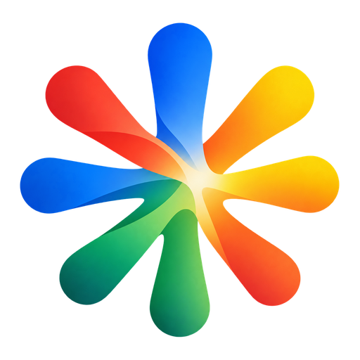
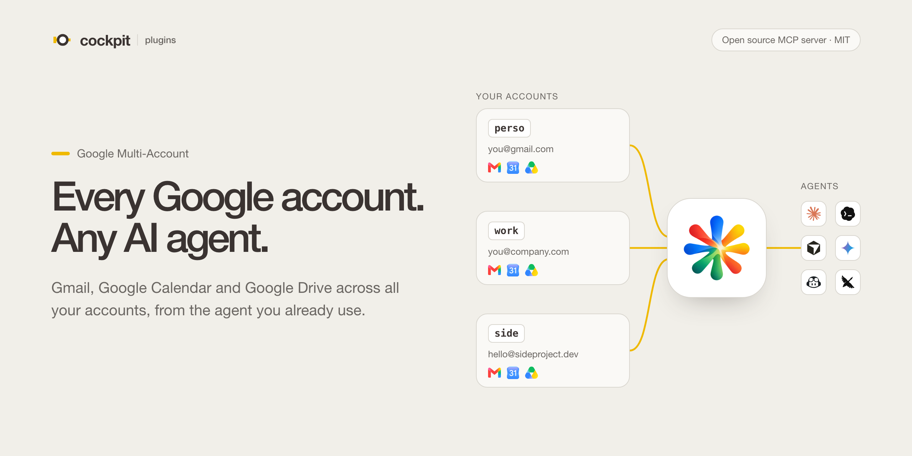
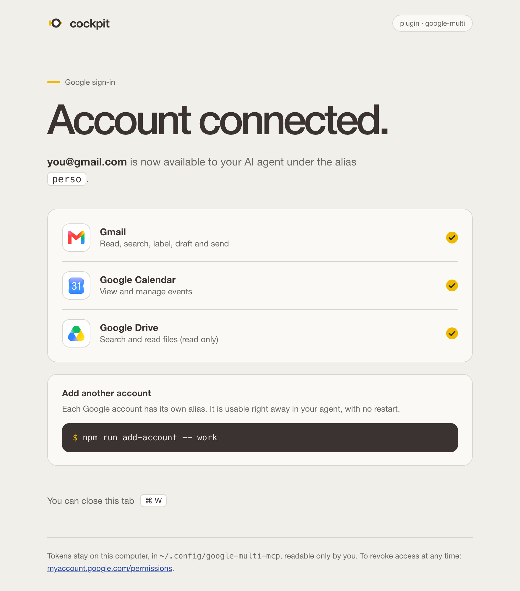

<p align="center">
  
</p>

<h1 align="center">google-multi-mcp</h1>

<p align="center">
  An open source MCP server that connects <strong>several Google accounts</strong> to your AI agent at once:<br>
  Gmail, Google Calendar and Google Drive.
</p>

<p align="center">
  <a href="https://plugin.usecockpit.co/google-multi/">Website</a> ·
  <a href="#install">Install</a> ·
  <a href="#with-docker">Docker</a> ·
  <a href="#tools">Tools</a> ·
  <a href="https://plugin.usecockpit.co/privacy/">Privacy</a>
</p>

[](https://plugin.usecockpit.co/google-multi/)

Built-in AI connectors usually link one Google account each. This server links all of them, personal, work and side projects, to any agent that speaks the [Model Context Protocol](https://modelcontextprotocol.io). Every tool takes an `account` parameter: an alias you choose (`perso`, `work`), an email address, or `all` for reads.

It runs on your own machine with your own OAuth client. Tokens stay in `~/.config/google-multi-mcp/` (mode `600`), never in this repository, and no data goes through Cockpit servers.

## What you can ask

- "Summarize my unread mail from this week on all my accounts."
- "Show tomorrow's agenda, personal and work merged, and flag the conflicts."
- "Draft a reply to Julie's last email from my work account."
- "Find the 'roofing' quote in all my Drives and summarize it."

Reads can span every account: each one is queried in parallel, and one failing account never blocks the others. Writes are always explicit: sending an email or changing an event requires a single, named account, so a work email never leaves from your personal address by accident.

## Works with your agent

The server speaks MCP over stdio, so it works with Claude, Codex, Cursor, Gemini CLI, GitHub Copilot, Goose and any other MCP client. It also ships as a Docker image.


## Tools

| Tool | What it does | `account="all"` |
|---|---|---|
| `list_accounts` | Connected accounts and their aliases | |
| `gmail_search` | Search emails with Gmail syntax | Yes |
| `gmail_read` | Read a message or a whole thread | |
| `gmail_create_draft` | Create a draft, new or as a reply | |
| `gmail_send` | Send an email, new or as a reply | |
| `gmail_modify_labels` | Archive, mark as read, star, label | |
| `calendar_list_calendars` | List calendars | Yes |
| `calendar_list_events` | Events over a period, merged across accounts | Yes |
| `calendar_create_event` | Create an event, optionally with Google Meet | |
| `calendar_update_event` | Change only the fields you pass | |
| `calendar_delete_event` | Delete or cancel an event | |
| `drive_search` | Full text or raw Drive query search | Yes |
| `drive_read_file` | Read Docs, Slides, Sheets (CSV) and text files | |

## Install

About 15 minutes, once. You need Node.js 20 or later (or Docker, see [With Docker](#with-docker)), a Google account to host the OAuth client, and an MCP client.

### 1. Create the Google OAuth client

A single OAuth client serves all your accounts.

1. Open <https://console.cloud.google.com/projectcreate> and create a project, for example `google-multi-mcp`.
2. Enable the three APIs in that project:
   - <https://console.cloud.google.com/apis/library/gmail.googleapis.com>
   - <https://console.cloud.google.com/apis/library/calendar-json.googleapis.com>
   - <https://console.cloud.google.com/apis/library/drive.googleapis.com>
3. Go to **Google Auth Platform** (<https://console.cloud.google.com/auth/overview>) and configure the consent screen: audience type **External**, an app name, your contact email.
4. In the **Audience** tab, click **Publish app** to move it to *Production*. This matters: in *Testing* mode, Google expires the authorizations **every 7 days**. The app stays "unverified", which is fine for personal use (fewer than 100 users): you only see a warning when you sign in.
5. In the **Clients** tab, click **Create client**, choose the type **Desktop app**, click **Create**, then download the JSON file.
6. Store that file:

```bash
mkdir -p ~/.config/google-multi-mcp && mv ~/Downloads/client_secret_*.json ~/.config/google-multi-mcp/client_secret.json && chmod 600 ~/.config/google-multi-mcp/client_secret.json
```

### 2. Get the code and build it

```bash
git clone https://github.com/dathims/google-multi-mcp.git && cd google-multi-mcp && npm install && npm run build
```

### 3. Add your accounts

One command per account. Your browser opens: pick the right Google account, click **Advanced**, then **Go to ... (unsafe)**, and tick every permission.

```bash
npm run add-account -- perso
```

```bash
npm run add-account -- work
```

When Google hands control back, the server confirms which services were granted:

<p align="center">
  
</p>

Other commands: `npm run list-accounts`, `npm run check-accounts`, `npm run remove-account -- <alias>`. A new account is available to your agent right away, with no restart.

### 4. Connect it to your agent

Point your MCP client at `dist/index.js`. Replace the path with the absolute path of your clone.

**Claude Code**

```bash
claude mcp add google-multi -s user -- node /path/to/google-multi-mcp/dist/index.js
```

**Codex**, in `~/.codex/config.toml`

```toml
[mcp_servers.google-multi]
command = "node"
args = ["/path/to/google-multi-mcp/dist/index.js"]
```

**Claude Desktop** (`~/Library/Application Support/Claude/claude_desktop_config.json`), **Cursor** (`~/.cursor/mcp.json`) and **Gemini CLI** (`~/.gemini/settings.json`) share the same format:

```json
{
  "mcpServers": {
    "google-multi": {
      "command": "node",
      "args": ["/path/to/google-multi-mcp/dist/index.js"]
    }
  }
}
```

Restart the client after editing its configuration file. If it cannot find `node`, use its absolute path (the output of `which node`) as the command.

**Claude Desktop, as an extension with its icon**: `npm run bundle` builds `google-multi.mcpb`. Double-click that file, or drop it into **Settings > Extensions**, then remove the `google-multi` entry from `claude_desktop_config.json` so the server is not loaded twice. Your accounts stay in `~/.config/google-multi-mcp/`.

### Variant: one connector per account

To turn each account on or off separately in your client, declare several entries that point to the same server with a filter:

```json
"google-perso": { "command": "node", "args": [".../dist/index.js", "--accounts=perso"] },
"google-work":  { "command": "node", "args": [".../dist/index.js", "--accounts=work"] }
```

## With Docker

A ready-made image is published for amd64 and arm64: `ghcr.io/dathims/google-multi-mcp`. No Node.js and no clone needed. Only step 1 (the Google OAuth client) is still required.

**Add an account.** The browser cannot open from inside the container: copy the URL it prints. Port 8765 is published on `127.0.0.1` only, to receive the answer from Google.

```bash
docker run -it --rm -p 127.0.0.1:8765:8765 -v ~/.config/google-multi-mcp:/config ghcr.io/dathims/google-multi-mcp add perso
```

Other commands: `list`, `check`, `remove <alias>` in place of `add perso`.

**Connect your agent.** Same format for Claude Desktop, Cursor and Gemini CLI. Replace the path with yours and `TZ` with your time zone: without it, the container runs in UTC and event times would shift.

```json
{
  "mcpServers": {
    "google-multi": {
      "command": "docker",
      "args": ["run", "-i", "--rm", "-e", "TZ=Europe/Paris",
               "-v", "/Users/you/.config/google-multi-mcp:/config",
               "ghcr.io/dathims/google-multi-mcp"]
    }
  }
}
```

On Linux, add `"--user", "<uid>:<gid>"` (the values of `id -u` and `id -g`) so the container can read the files in mode `600`. Not needed on macOS with Docker Desktop.

## Troubleshooting

| Symptom | Cause and fix |
|---|---|
| `invalid_grant` | The authorization expired or was revoked. Run `npm run add-account -- <alias>` again. If it comes back every 7 days, the app is still in Testing mode (step 1.4). |
| "Access blocked: this app is not verified" on a work account | The Google Workspace administrator blocks unverified third-party apps. Ask them to allow the client ID, or create the Google Cloud project inside the Workspace organization. |
| `OAuth client file not found` | The file from step 1.6 is missing or in the wrong place. |
| A tool fails on a single account | A permission was left unticked when signing in: add the account again. |

## Security

- Tokens are stored locally, files in mode `600`, folder in mode `700`.
- OAuth sign-in with PKCE and a check of the `state` parameter.
- Drive is **read only**. Gmail cannot permanently delete anything (scope `gmail.modify`).
- Writes (sending, calendar changes) always require an explicit account: `all` is refused.
- Revoke access on the Google side at any time: <https://myaccount.google.com/permissions>.

## More on the website

The plugin has its own page on the Cockpit marketplace, with the same install steps and the privacy policy.

[](https://plugin.usecockpit.co/google-multi/)

## License

[MIT](LICENSE), © 2026 OXYGENE NUMERIQUE. Google, Gmail, Google Calendar and Google Drive are trademarks of Google LLC; Claude is a trademark of Anthropic PBC. Other product names and logos belong to their respective owners and are used only to show compatibility. This independent project is not affiliated with or endorsed by any of them.

Privacy: <https://plugin.usecockpit.co/privacy/>
